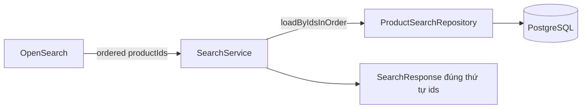

# Kiến trúc OpenSearch Full-Text Search — Flash Sale B2C

> **Source of Truth** cho tính năng full-text search của storefront `/search`.
> Tài liệu này mô tả kiến trúc, cơ chế phân trang, mapping index, pipeline đồng bộ dữ liệu,
> chiến lược fallback và hướng dẫn vận hành.
>
> - Backend: `flash-sale-b2c-UTC2` (Spring Boot 4 / Java 25)
> - Frontend: `flash-sale-b2c-fe` (Next.js 16 / React 19)
> - Hạ tầng: `deploy-b2c-utc2` (Docker Compose)

---

## 1. Tóm tắt quyết định kiến trúc

| Hạng mục | Quyết định | Lý do |
|---|---|---|
| Vai trò của OpenSearch | **Bộ lọc + bộ xếp hạng** (trả về `productId` theo thứ tự relevance) | Không bao giờ hiển thị dữ liệu stale; index nhỏ; dữ liệu hiển thị luôn từ PostgreSQL |
| Mô hình dữ liệu | **Search-then-hydrate** | OS trả IDs → BE hydrate từ DB bằng 1 query `IN (...)`, giữ thứ tự relevance bằng `LinkedHashMap` |
| Cơ chế phân trang | **PIT + `search_after`** | Deep pagination không giới hạn `max_result_window`, snapshot đóng băng → thứ tự ổn định |
| Cursor phía FE | **Token opaque ký HMAC-SHA256** | FE không biết `pitId`/`search_after`; chống giả mạo; BE toàn quyền quản lý PIT |
| Khi OS lỗi/timeout | **Fallback sang PostgreSQL `LIKE`** | Trả **cùng shape** → FE không cần biết nhánh nào đã chạy |
| Tiếng Việt | **`analysis-icu` plugin + `icu_folding`** | `asciifolding` không map được `đ` (U+0111) → "đồ" không khớp "do" |
| Frontend | **Cuộn vô hạn + virtualization** | DOM phình vô hạn nếu không windowing → jank + RAM |

---

## 2. Mô hình Search-Then-Hydrate



### 2.1 Luồng xử lý một request

```
GET /api/v1/products/search?q=điện%20thoại&sort=relevance
        │
        ▼
SearchServiceImpl
        │
        ├─► CursorCodec.decode(cursor)        # nếu có cursor → lấy pitId + search_after
        │
        ├─► OpenSearchGateway.search(...)
        │      ├─ tạo PIT (keep_alive=2m) nếu chưa có
        │      ├─ gửi query: must=fulltext, filter=context filters, post_filter=selected filters
        │      ├─ "_source": false  ← chỉ lấy hits[]._id
        │      └─ trả về: List<Long> ids (đã sort), sortValues, total, hasMore
        │
        ├─► ProductSearchRepository.loadByIdsInOrder(ids)
        │      └─ 1 query: SELECT ... WHERE id = ANY(:ids) AND status='ACTIVE'
        │         → LinkedHashMap<Long, RecommendedProductResponse>  (giữ thứ tự ids)
        │
        ├─► compact: bỏ ID không hydrate được (sản phẩm bị xoá/ẩn)
        │
        └─► SearchResponse { items, total, size, nextCursor, hasMore, totalIsExact, facets }
```

### 2.2 Tại sao không lấy `_source` từ OpenSearch

- Băng thông OS → BE giảm tối đa (chỉ IDs).
- Dữ liệu trả về cho FE luôn lấy từ PostgreSQL → **không bao giờ stale** (giá, tồn kho, trạng thái).
- Index chỉ cần chứa field phục vụ **filter + sort + match** → index nhỏ hơn nhiều.

### 2.3 Defense layer (2 lớp)

| Lớp | Vị trí | Việc |
|---|---|---|
| Layer 1 | OpenSearch query | `filter: { term: { status: "ACTIVE" } }` |
| Layer 2 | SQL hydrate | `AND p.status = 'ACTIVE' AND s.status = 'APPROVED'` |

Nếu index chưa cập nhật (sản phẩm vừa bị ẩn), Layer 2 vẫn loại bỏ đúng.

### 2.4 Xử lý sản phẩm bị xoá/ẩn giữa chừng

Tình huống: OS trả ID `[10, 20, 30]`, nhưng DB chỉ còn `[20, 30]` (ID 10 vừa bị xoá).

- `items` phải là **list đã compact** — bỏ ID không hydrate được, **không** trả `null`/`Optional.empty` rải rác (FE sẽ render ô rỗng).
- `totalIsExact = false` — tổng số từ OS không còn khớp chính xác với số item thực trả về.
- `hasMore` phải tính từ **cả** `hasMore` của OS **và** việc DB có lọc bỏ. Nếu OS báo còn trang nhưng DB lọc hết ID của trang đó → **vẫn phải cấp `nextCursor`** để FE không kẹt vô hạn ở trang đó.

### 2.5 Bảo toàn thứ tự relevance

```java
// ✅ Đúng — giữ đúng thứ tự IDs do OpenSearch quyết định
Map<Long, RecommendedProductResponse> map = new LinkedHashMap<>();
for (Product p : products) {         // products đã được sắp theo thứ tự ids
    map.put(p.getId(), toResponse(p));
}
List<RecommendedProductResponse> items = ids.stream()
        .map(map::get)
        .filter(Objects::nonNull)     // compact — bỏ ID không tồn tại
        .toList();
```

❌ **KHÔNG** dùng `findAllById` (không đảm bảo thứ tự).
❌ **KHÔNG** `ORDER BY` lại trong SQL (sẽ phá thứ tự relevance).

---

## 3. Phân trang: PIT + `search_after`

### 3.1 Vì sao không dùng `from/size`

| Cơ chế | Hạn chế | Kết luận |
|---|---|---|
| `from/size` | `from+size` > `index.max_result_window` (mặc định 10000) → bị từ chối. Mỗi shard thu thập + sort `from+size` doc → chi phí O(n²). | **LOẠI** |
| `scroll` | Gắn cứng 1 query, chỉ đi tới, giữ context server-side lâu | **LOẠI** |
| `search_after` | Stateless, nhưng **không nhất quán** khi có doc index đồng thời → trùng/thiếu item giữa 2 trang. Cần unique tiebreaker. | Chưa đủ |
| **PIT + `search_after`** | Snapshot đóng băng dữ liệu, đi tới/lui, không giới hạn window, không gắn với query, chi phí O(size) | **CHỌN** |

> ⚠️ **Không** nâng `index.max_result_window` — đó là "vá" sai, chỉ che triệu chứng và tăng rủi ro OOM.

### 3.2 Sort key — luôn kết thúc bằng tiebreaker duy nhất

| `sort` | OpenSearch sort clause |
|---|---|
| `relevance` | `_score:desc`, `productId:asc` |
| `newest` | `createdAt:desc`, `productId:asc` |
| `best_selling` | `totalSold:desc`, `productId:asc` |
| `price_asc` | `minPrice:asc`, `productId:asc` |
| `price_desc` | `minPrice:desc`, `productId:asc` |

Nếu thiếu tiebreaker `productId`, các doc có cùng giá trị sort có thể bị **trùng hoặc thiếu** giữa 2 trang.

### 3.3 Token cursor (opaque, ký HMAC)

Payload (Base64url) + chữ ký HMAC-SHA256 bằng `SEARCH_CURSOR_SECRET`:

```json
{
  "v": 1,
  "mode": "OS_PIT",
  "pitId": "<base64 pit id>",
  "sa": [<sort values của hit cuối>],
  "offset": 20,
  "sort": "relevance",
  "fh": "<sha256 của q+filters>",
  "iat": 1790246400
}
```

| Field | Ý nghĩa |
|---|---|
| `sa` | Mảng `search_after`, lấy từ `hits.hits[last].sort` |
| `offset` | Offset tương ứng — dùng cho **nhánh fallback DB** (DB không có `search_after`) |
| `fh` | Fingerprint của `q` + filters. User đổi filter/sort → `fh` lệch → BE **bỏ cursor** và trả trang đầu (tránh trộn kết quả 2 query khác nhau) |
| `sort` | Sort key — BE validate phải khớp với request hiện tại, lệch → bỏ cursor |
| `iat` | Timestamp — dùng cho TTL (chống cursor sống quá lâu) |

Chữ ký HMAC **không** dùng để che bí mật — dùng để bảo đảm **tính toàn vẹn** (chống client giả mạo `pitId`/`search_after`).

### 3.4 Vòng đời PIT

1. **Request đầu** (không `cursor`): BE tạo PIT (`keep_alive=2m`), search `size=24`, trả `nextCursor` chứa `pitId` mới.
2. **Request sau** (`cursor`): BE mở PIT từ token, search với `search_after=sa`, `keep_alive=2m` → **PIT id được gia hạn và thay đổi** → BE phải cập nhật `pitId` mới vào `nextCursor`.
3. **PIT hết hạn** (user cuộn quá lâu): OS trả `search_phase_execution_exception`. BE **bắt lỗi → tạo PIT mới → search lại với `search_after=sa`** (không cần PIT cũ cho `search_after` thuần). Kết quả tiếp tục gần đúng vị trí đang dừng. **Không** báo lỗi ra FE.
4. `hasMore = false` khi `hits.length < size` → FE ngừng gọi.

### 3.5 Nhánh fallback DB

Khi OS lỗi/timeout → BE chạy query SQL (`LOWER(name) LIKE`) với **offset** lấy từ `offset` trong token, giới hạn sâu tối đa **10 trang (240 item)** rồi dừng (`hasMore=false`).

Fallback là **chế độ degraded** — không cần deep pagination. Response **luôn cùng shape** ở cả 2 nhánh → FE không cần biết nhánh nào đã chạy.

> Facets của nhánh DB đến từ `SearchFacetsDto` hiện có (query SQL group-by), không từ OS → 2 nhánh có thể lệch nhau ở các số đếm nhỏ. Chấp nhận và ghi rõ trong doc.

---

## 4. Mapping index (bootstrap idempotent)

- Index thật: `products_v1` · Alias: `products` (alias cho phép reindex không downtime).
- **Luôn query alias**, không query index thật.

### 4.1 Analyzer

```json
"analysis": {
  "analyzer": {
    "vi_exact":  { "tokenizer": "icu_tokenizer", "filter": ["lowercase"] },
    "vi_folded": { "tokenizer": "icu_tokenizer", "filter": ["icu_folding", "lowercase"] }
  }
}
```

`icu_tokenizer` + `icu_folding` cần plugin `analysis-icu` → bắt buộc custom Docker image.

### 4.2 Mapping

```json
{
  "settings": {
    "index": {
      "number_of_shards": 1,
      "number_of_replicas": 0,
      "max_result_window": 10000
    }
  },
  "mappings": {
    "properties": {
      "id":          { "type": "long" },
      "name":        { "type": "text", "analyzer": "vi_exact",
                       "fields": { "folded": { "type": "text", "analyzer": "vi_folded" } } },
      "brand":       { "type": "keyword" },
      "storeId":     { "type": "long" },
      "storeTier":   { "type": "keyword" },
      "categoryId":  { "type": "integer" },
      "categorySlug":{ "type": "keyword" },
      "minPrice":    { "type": "scaled_float", "scaling_factor": 100 },
      "maxPrice":    { "type": "scaled_float", "scaling_factor": 100 },
      "totalStock":  { "type": "integer" },
      "totalSold":   { "type": "integer" },
      "ratingAvg":   { "type": "half_float" },
      "ratingCount": { "type": "integer" },
      "isFlashSale": { "type": "boolean" },
      "hasDiscount": { "type": "boolean" },
      "hasVoucher":  { "type": "boolean" },
      "freeship":    { "type": "boolean" },
      "status":      { "type": "keyword" },
      "createdAt":   { "type": "date" },
      "updatedAt":   { "type": "date" }
    }
  }
}
```

**Giữ (bắt buộc)**: các field phục vụ filter + sort + match.
**Bỏ (không cần)**: `description` (không match sâu, chỉ tốn index), `imageUrl` / `storeName` (DB hydrate lấy lại).

> ⚠️ Thứ tự sort phụ thuộc field denormalized (`minPrice`, `totalSold`, `ratingAvg`). Nếu field lệch với DB, thứ tự có thể "lạc" so với kỳ vọng → **chấp nhận được** (sort theo index snapshot), đã ghi rõ trong doc này.

### 4.3 Field denormalize từ DB

| Field | Nguồn |
|---|---|
| `minPrice` / `maxPrice` | `MIN/MAX(variants.original_price)` |
| `totalStock` | `SUM(variants.stock_quantity)` |
| `ratingAvg` / `ratingCount` | `AVG/COUNT(reviews.rating)` |
| `storeTier` | `stores.tier` |
| `categorySlug` | `categories.slug` |

---

## 5. Pipeline index (không dual-write trong transaction)

❌ **KHÔNG** gọi OS trong `@Transactional` của `createProduct`/`updateProduct` — rủi ro transaction rollback nhưng doc đã index → lệch dữ liệu.

Cơ chế 2 lớp:

1. **Event sau commit**: `ProductServiceImpl` publish `ProductIndexEvent` → listener `@TransactionalEventListener(phase = AFTER_COMMIT)` → đẩy vào hàng đợi → worker bulk upsert.
2. **Reconcile định kỳ**: `@Scheduled(fixedDelayString = "${app.scheduler.search-reindex-delay:600000}")` quét product thay đổi theo `updated_at` → upsert lại (**idempotent**). Dùng batch nhỏ + `FOR UPDATE SKIP LOCKED` để an toàn multi-instance.

**Bootstrap lần đầu**: job full-reindex (đọc hết `products` ACTIVE + store APPROVED), idempotent, log số lượng.

---

## 6. Tối ưu tài nguyên query OpenSearch

- **Phân biệt `must` vs `filter`**: `must` = full-text query (có scoring). `filter` = category/price/service/rating (context filter → **cached, không scoring**). Đặt filter trong `bool.filter`.
- **`post_filter` cho filter đang chọn + `aggs` trên query gốc**: nếu đưa filter vào `query`, chọn 1 category sẽ làm count của các category khác về 0 — lỗi facet kinh điển. `aggs` phải chạy trên query **không filter**, còn `post_filter` lọc hits.
- **`"_source": false`** → OS chỉ trả `hits.hits[]._id`.
- **`track_total_hits: 10000`** → không đếm chính xác toàn bộ match (tốn CPU). Response trả `totalIsExact=false` khi bị cap.
- **`size` = 24** — không dùng `highlight` (rất tốn CPU).
- **Shard = 1, replica = 0** ở local. Prod cân nhắc 1 primary + 1 replica.
- **Timeout fail-fast**: `socket-timeout-ms=3000` + `request-timeout-ms=1500` → OS chậm thì chuyển fallback DB thay vì giữ thread request.
- **Hydrate = 1 query `WHERE id = ANY(:ids)`** — KHÔNG N lần `findById` (rule `20-n-plus-one.mdc`).

---

## 7. Hạ tầng Docker

### 7.1 Files

| File | Repo | Loại |
|---|---|---|
| `docker-compose.yml` | deploy | Sửa — thêm service `opensearch` |
| `docker/opensearch/Dockerfile` | deploy | Tạo — cài `analysis-icu` |
| `.env.example` | deploy | Sửa — thêm biến OS |
| `.env` | deploy | Sửa (gitignored) — giá trị thật |

### 7.2 Password — `mysecretpassword` KHÔNG dùng được

Từ OpenSearch 2.12, `OPENSEARCH_INITIAL_ADMIN_PASSWORD` bị installer kiểm tra: **8–100 ký tự**, có hoa + thường + số + ký tự đặc biệt, và zxcvbn phải ≥ "strong". `mysecretpassword` (18 ký tự) thiếu hoa/số/ký tự đặc biệt → **container exit code 1 ngay khi boot**.

Dùng: `Vnd#m4Kq7!zX2pL9w` (17 ký tự, không chứa từ điển, không giống "admin").

> ⚠️ Biến này chỉ được đọc **một lần** lần khởi động đầu. Đổi trong `.env` sau đó **không có tác dụng** — phải `docker compose down -v` rồi `up` lại.

### 7.3 Lệnh vận hành

```bash
# Build + start riêng OpenSearch
docker compose build opensearch
docker compose up -d opensearch

# Kiểm tra health
curl -k -u admin:"Vnd#m4Kq7!zX2pL9w" https://localhost:9200/_cluster/health

# Xem plugin đã cài
docker compose exec opensearch /usr/share/opensearch/bin/opensearch-plugin list

# Xoá index + build lại (khi đổi mapping)
docker compose down -v
docker compose up -d opensearch
```

### 7.4 Kết nối từ Backend

| Môi trường | `OPENSEARCH_HOST` |
|---|---|
| Local (BE chạy `gradlew bootRun` trên host) | `https://localhost:9200` |
| Prod (BE trong Docker) | `https://opensearch:9200` |

Backend dùng `https` + **trust-all SSLContext** cho local (demo cert tự ký). **Prod phải** thay bằng cert thật + truststore — không dùng trust-all ở prod (`ssl-trust-all: false`).

---

## 8. Cấu hình Backend

```yaml
opensearch:
  host: ${OPENSEARCH_HOST:https://localhost:9200}
  username: ${OPENSEARCH_USERNAME:admin}
  password: ${OPENSEARCH_PASSWORD:}
  index-alias: ${OPENSEARCH_INDEX_ALIAS:products}
  connect-timeout-ms: ${OPENSEARCH_CONNECT_TIMEOUT_MS:2000}
  socket-timeout-ms: ${OPENSEARCH_SOCKET_TIMEOUT_MS:3000}
  ssl-trust-all: ${OPENSEARCH_SSL_TRUST_ALL:false}
  search:
    page-size: ${OPENSEARCH_PAGE_SIZE:24}
    pit-keep-alive: ${OPENSEARCH_PIT_KEEP_ALIVE:2m}
    request-timeout-ms: ${OPENSEARCH_REQUEST_TIMEOUT_MS:1500}
  cursor-secret: ${SEARCH_CURSOR_SECRET:}
```

- `application-local.yaml` → `ssl-trust-all: true` (demo cert tự ký).
- `application-prod.yaml` → `ssl-trust-all: false`, `socket-timeout-ms` thấp hơn.

---

## 9. API contract (breaking change)

### Request — `GET /api/v1/products/search`

| Param | Thay đổi | Ghi chú |
|---|---|---|
| `q` | giữ | Từ khoá full-text |
| `subcategory`, `city`, `service` | giữ | Danh sách |
| `priceMin`, `priceMax`, `rating` | giữ | |
| `sort` | giữ | `relevance` \| `newest` \| `best_selling` \| `price_asc` \| `price_desc` |
| `page` | **BỎ** | |
| `cursor` | **THÊM** | Token opaque, optional |

### Response — `SearchResponse`

| Field | Thay đổi |
|---|---|
| `items` | giữ (`List<RecommendedProductResponse>`) |
| `total` | giữ |
| `facets` | giữ (`SearchFacetsDto`) |
| `page` | **BỎ** |
| `pageSize` | → `size` |
| `nextCursor` | **THÊM** (`String`, `null` = hết) |
| `hasMore` | **THÊM** (`boolean`) |
| `totalIsExact` | **THÊM** (`boolean`) |

---

## 10. Frontend

| File | Thay đổi |
|---|---|
| `src/features/search/types.ts` | `SearchResult`: bỏ `page`/`pageSize` → thêm `size`, `nextCursor`, `hasMore`, `totalIsExact`. `SearchQuery`: bỏ `page`. `DEFAULT_SEARCH_SIZE = 24`. |
| `src/features/search/schemas.ts` | Xóa `page`, thêm `cursor` (parse cho chắc — cursor không nằm trong URL). |
| `src/features/search/api.ts` | `buildSearchQueryString`: bỏ `page`, thêm `cursor`. |
| `src/features/search/hooks.ts` | `useSearchProducts` (useQuery) → **`useInfiniteSearchProducts`** (`useInfiniteQuery`). Bỏ `usePrefetchNextPage`. |
| `src/app/(storefront)/search/page.tsx` | Bỏ `totalPages`; render `SearchProductGrid` client-side. |
| `src/components/storefront/search/SearchPageContent.tsx` | Nhận `initialData` + `hasNextPage`; render sentinel; bỏ `<SearchPagination>`. |
| `src/components/storefront/search/SearchProductGrid.tsx` | `useVirtualizer`; render cửa sổ item; sentinel ref; dedupe theo id. |
| `src/components/storefront/search/SearchSortBar.tsx` | Bỏ mini-pagination `1/42` → hiển thị tổng kết quả (`N+` nếu `totalIsExact=false`). |
| `src/components/storefront/search/SearchPagination.tsx` | **XÓA** — không thể nhảy tới trang N với cursor. |

### 10.1 Cơ chế cuộn vô hạn

- `IntersectionObserver` trên 1 sentinel div cuối grid → khi vào viewport → `fetchNextPage()`.
- Nút "Xem thêm" là fallback (a11y + trường hợp observer fail) — đặt cạnh sentinel.
- **Dedup**: index thay đổi giữa 2 trang → cùng 1 `productId` có thể xuất hiện 2 lần → dedupe theo id, giữ thứ tự chèn.
- **Reset**: đổi `q`/filter/sort → reset cursor list, scroll về đầu grid, huỷ request in-flight (`AbortController` qua RQ `signal`).
- **Debounce ô tìm kiếm**: 300ms trước khi gọi API.
- **KHÔNG đưa `cursor` vào URL** — token dài và opaque; URL chỉ giữ `q`, filter, `sort`.
- Query config: `staleTime: 30_000`, `gcTime: 5 * 60_000`, `refetchOnWindowFocus: false`.

### 10.2 Rủi ro Frontend

| Rủi ro | Giảm thiểu |
|---|---|
| DOM phình vô hạn | `useVirtualizer` (bắt buộc, không chỉ `fetchNextPage`) |
| Gọi API mỗi lần scroll quá nhanh | Guard `hasNextPage` + `isFetchingNextPage` |
| Song song 2 request (đổi filter khi đang scroll) | Huỷ request cũ, tránh setState sau unmount |
| Mất `nextCursor` do re-render | Lưu trong cache RQ, không trong local state đơn lẻ |
| CLS do ảnh | `next/image` + `loading="lazy"`, virtualizer tính `height` |
| Text hard-code | Thêm key vào **cả** `messages/vi.json` **và** `messages/en.json` |

---

## 11. Kiểm thử

### Backend (JUnit)

| Test | Nội dung |
|---|---|
| `CursorCodec` | round-trip encode/decode, tamper detection, `fh` mismatch → bỏ cursor |
| `SearchServiceImpl` | OS OK → trả OS; OS timeout → trả fallback DB; PIT expired → tạo PIT mới + `search_after` (không throw) |
| `OpenSearchGateway` | mapping `search_after` + sort + tiebreaker đúng; request phải có `"_source": false` và chỉ trả `List<Long>` |
| `SearchServiceImpl` (search-then-hydrate) | OS trả `[3,1,2]` → `items` theo đúng thứ tự `[3,1,2]`; ID không tồn tại → **bị loại bỏ**, `items` không chứa null/rỗng; `totalIsExact=false` khi có ID bị loại |
| `SearchServiceImpl` | `hasMore` vẫn `true` khi OS còn trang dù DB lọc hết ID → phải cấp `nextCursor` |
| `ProductSearchRepository.loadByIdsInOrder` | 1 query duy nhất (không N+1), giữ thứ tự ids, filter `status='ACTIVE'` |
| `ProductIndexer` | bulk upsert idempotent |

### Frontend (Vitest)

| Test | Nội dung |
|---|---|
| `useInfiniteSearchProducts` | `fetchNextPage`, `hasMore=false` → dừng |
| `SearchProductGrid` | render virtual window, dedupe |
| reset cursor | đổi filter → cursor list reset |

### E2E

**KHÔNG** set up (rule `no-overengineering.mdc` — manual test đủ).

---

## 12. Bảng rủi ro tổng thể

| Rủi ro | Mức | Giảm thiểu |
|---|---|---|
| Index lệch với DB | Cao | Event sau-commit + reconcile định kỳ idempotent; không dual-write trong transaction |
| OS chết giữa chừng | Trung bình | Fallback DB trả cùng shape; FE không cần biết |
| **ID từ OS không tồn tại trong DB** | Trung bình | Compact `items`; filter `status='ACTIVE'` ở SQL; `totalIsExact=false`; vẫn cấp `nextCursor` |
| **Hydrate sai thứ tự relevance** | Cao | `LinkedHashMap` theo đúng thứ tự ids OS trả; KHÔNG `ORDER BY` lại trong SQL |
| N+1 khi hydrate | Trung bình | 1 query `WHERE id = ANY(:ids)` duy nhất |
| PIT hết hạn khi user cuộn chậm | Trung bình | Bắt lỗi → tạo PIT mới + `search_after` thuần; không lỗi ra FE |
| Deep pagination làm nghẽn cluster | Cao (nếu chọn sai) | Bắt buộc PIT+search_after; cấm `from/size`; `size`=24; `track_total_hits` cap |
| DOM phình vô hạn ở FE | Cao | `useVirtualizer` |
| Password yếu / OS mở public | Cao | Password mạnh qua `.env`; bind `127.0.0.1`; prod dùng TLS thật |
| Lỗi `đ` không match `d` | Trung bình | `analysis-icu` + `icu_folding` |

---

## 13. Ngoài phạm vi

- Dashboards / OpenSearch Dashboards container
- Vector search / semantic search (đủ dùng BM25)
- Multi-node cluster, replica, ILM, snapshot
- Gợi ý "did you mean" / fuzzy autocomplete
- Viết lại `SearchFilterSidebar` (giữ nguyên, chỉ đổi nguồn data facets)

---

## 14. Liên quan

- `docs/api/api-document.md` — contract API chi tiết
- `.cursor/rules/13-flashsale-architecture.mdc` — kiến trúc Flash Sale
- `.cursor/rules/18-concurrency.mdc` — xử lý concurrency
- `.cursor/rules/20-n-plus-one.mdc` — quy tắc truy vấn N+1
- `.cursor/rules/19-schedulers.mdc` — quy tắc scheduled job
